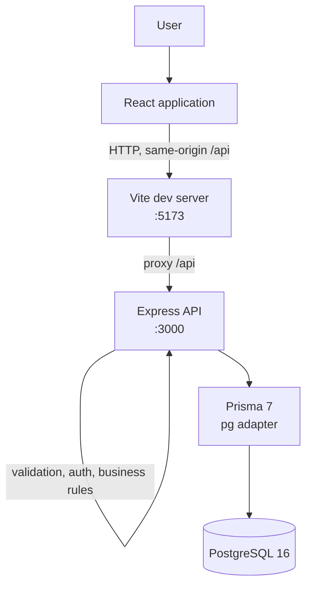

# Architecture

This document describes the implementation that exists in the repository. The older [System Architecture](System%20Architecture.md) and [Detailed Design](Detailed%20Design.md) documents describe the original design; where they differ, the code and the current README/API documentation are authoritative.

## 1. System Context



The application runs as three containers:

- `frontend`: Vite development server serving the React application.
- `backend`: Express API running under `tsx watch`.
- `postgres`: PostgreSQL 16, with a named volume for persistence.

The browser does not call the backend container directly. It calls `/api` on the Vite origin, and Vite proxies that path to `http://backend:3000` inside Docker (or `http://localhost:3000` for a host-run Vite server). This avoids cross-origin requests because the backend does not implement CORS.

## 2. Responsibilities

### Frontend

- Renders authentication pages, protected application pages, and shared layout/navigation.
- Declares routes for `/login`, `/register`, `/dashboard`, `/accounts`, `/categories`, `/transactions`, `/budgets`, and `/reports`; `/` redirects to `/dashboard`.
- Guards authenticated pages with `ProtectedRoute`. This is a user-experience guard, not the security boundary.
- Uses React Hook Form with Zod schemas for form validation.
- Uses TanStack Query for server state, caching, invalidation, and loading/error states.
- Calls the backend through a single JSON API client. The authenticated wrapper attaches the access token and retries one failed request after refreshing the session.
- Stores the access and refresh tokens in `localStorage` to restore sessions across reloads.

### Backend

- Exposes the REST API under `/api`.
- Validates request bodies, query strings, and path parameters with Zod before controllers run.
- Verifies JWTs, derives the authenticated user ID, and rejects missing or invalid credentials.
- Enforces resource ownership by including `userId` in data-access queries.
- Owns business rules: account balance changes, category/type matching, budget creation and progress, dashboard aggregation, and report aggregation.
- Returns a consistent error envelope and hides unexpected internal errors.

### Database

- Stores users and refresh-token records.
- Stores accounts, income/expense categories, transactions, budgets, and test-only resources.
- Enforces uniqueness for user emails, category names per user/type, and budgets per user/category/year/month.
- Enforces referential actions:
  - deleting a user cascades to their refresh tokens, accounts, categories, transactions, budgets, and test resources;
  - deleting an account or category referenced by a transaction is restricted;
  - deleting a category cascades to its budgets.

## 3. Backend Structure and Request Flow

```text
Express app (src/app.ts)
  -> /api router (src/routes/api.routes.ts)
     -> feature router
        -> authentication middleware (protected routes)
        -> validation middleware
        -> controller
        -> service
        -> repository
        -> Prisma client
        -> PostgreSQL
     -> not-found handler
  -> centralized error middleware
```

Feature modules live under `backend/src/modules/`:

- `auth`
- `account`
- `category`
- `transaction`
- `budget`
- `dashboard`
- `reports`
- `health`
- `test-resources`

Controllers translate HTTP requests into service calls. Services hold the business rules and use repositories for data access. Repositories receive an optional Prisma transaction client, allowing services to group related writes.

The error middleware maps `AppError` instances to the standard error response. Prisma unique/foreign-key conflicts (`P2002`, `P2003`) become `409` responses; other unexpected errors become a generic `500` response and are logged server-side.

## 4. Authentication and Authorization

### Token flow

1. Registration hashes the password with Argon2id and stores the user. It does not issue tokens.
2. Login verifies the password, signs an access JWT and a refresh JWT with separate secrets, hashes the refresh token, and stores the hash with its expiry.
3. Protected requests send `Authorization: Bearer <access-token>`.
4. Authentication middleware verifies the access JWT, requires a positive integer subject, and exposes the user ID to the request.
5. Refresh verifies the refresh JWT, looks up the stored hash, checks that it is active and belongs to the same user, revokes it, and creates a new refresh-token record.
6. Logout revokes the supplied refresh token when it belongs to the authenticated user.

Expiry values come from `ACCESS_TOKEN_EXPIRES_IN` and `REFRESH_TOKEN_EXPIRES_IN` and are interpreted by `jose`.

### Resource ownership

The client never supplies `userId`. Service and repository queries combine the resource ID with the authenticated user ID. Missing resources and resources owned by another user both produce `404`, so the API does not reveal whether another user's record exists.

Validation schemas are strict, so extra fields such as `userId` are rejected rather than ignored.

### Frontend session handling

The shared API client adds the access token. On a `401`, the authenticated wrapper attempts one refresh, replaces both stored tokens, and retries the original request once. Concurrent requests share a single in-flight refresh. If refresh fails, the stored tokens are cleared and the UI returns to the unauthenticated state.

## 5. Financial Data Integrity

Financial writes are executed inside `prisma.$transaction`:

- **Create transaction**: verify the account and category belong to the user, verify the category type matches the transaction type, update the balance, then create the transaction.
- **Expense**: `decreaseBalance` performs a conditional `updateMany` that requires `balance >= amount`. A zero-row update is treated as insufficient balance.
- **Income**: `increaseBalance` increments the balance.
- **Update transaction**: the service validates any new account/category, reverses the old balance effect, applies the new effect (including account moves), then updates the transaction.
- **Delete transaction**: reverses the transaction's balance effect, then deletes the record.

If any step throws, the Prisma transaction rolls back, so a balance change and its transaction record do not diverge.

Dashboard totals and reports are calculated from stored accounts and transactions using Prisma aggregates, `groupBy`, and one parameterized raw SQL query for daily cash flow. Monetary columns use PostgreSQL `DECIMAL(18,2)`; the backend uses Prisma `Decimal` for arithmetic and serializes amounts as strings or numbers for JSON responses.

## 6. Database and Migrations

The schema is in `backend/prisma/schema.prisma`. The Prisma client is generated into `backend/src/generated/prisma`, which is ignored by Git.

Main models:

| Model | Notes |
|---|---|
| `User` | Email is unique; password is stored only as a hash. |
| `RefreshToken` | Stores a unique token hash, expiry, and optional revocation time. |
| `Account` | Numeric ID, user-owned, decimal balance, typed account kind. |
| `Category` | UUID, user-owned, income or expense, normalized-name uniqueness per user/type. |
| `Transaction` | UUID, user-owned, decimal amount, date-only value, account/category references. |
| `Budget` | UUID, user-owned, month/year period, expense category, decimal amount. |
| `TestResource` | Test-support model; not part of the product domain. |

Migrations live in `backend/prisma/migrations/`. The normal workflow is `prisma migrate deploy`; schema changes during development use `prisma migrate dev`. Development and test databases are separate:

- `finance_db` is the development database created by Compose.
- `finance_test_db` is created manually for integration tests and migrated with the `.env.test` URL.

The integration test setup loads `.env.test` with `override: true`, clears users and refresh tokens before each test, and disables file-level parallelism because tests share the database.

## 7. Testing and CI

- Backend unit and API tests use Vitest and Supertest.
- Backend integration tests exercise routes, middleware, services, repositories, and PostgreSQL.
- Frontend tests use Vitest, Testing Library, and `jsdom`.
- GitHub Actions runs backend and frontend jobs with Node.js 22. The backend job provisions PostgreSQL 16, generates the Prisma client, migrates both databases, and runs lint, tests, integration tests, coverage, and the build. The frontend job runs lint, tests, and the build.

See [DEVELOPMENT.md](DEVELOPMENT.md#8-backend-tests) for exact commands and test-database setup.

## 8. Technical Decisions

- **Feature modules with controller/service/repository layers**: keeps HTTP, business rules, and persistence concerns separated and makes the financial rules testable.
- **Prisma transactions plus conditional balance updates**: prevents a transaction record from being written without its balance change, and avoids allowing an expense to overdraw an account.
- **Decimal monetary storage**: avoids floating-point storage for money.
- **JWT access/refresh split with hashed, rotated refresh tokens**: allows short-lived access tokens while limiting the usefulness of a stolen stored refresh token.
- **Strict Zod schemas on the server**: the server remains authoritative even though the frontend validates forms too.
- **Same-origin `/api` through the Vite proxy**: matches the current no-CORS backend design. A production deployment would need a reverse proxy or explicit CORS policy.
- **`localStorage` token storage**: simple session restoration, but it inherits XSS exposure. This is documented as a limitation rather than presented as a hardened production design.
- **Generated Prisma client is not committed**: CI and local setup must run `prisma generate`; this keeps generated code out of version control.

## 9. Known Gaps

- Test-support routes are mounted in the application and should be removed or gated before public deployment.
- There is no rate limiting, security-header middleware, email verification, password reset, or account lockout.
- Docker Compose runs development servers; it is not a production deployment configuration.
- The budget `NEAR_LIMIT` boundary includes exactly 100%, while an older design document described `OVER_BUDGET` as starting at 100%.
- See the [release readiness checklist](RELEASE_READINESS.md) for unresolved verification items.
