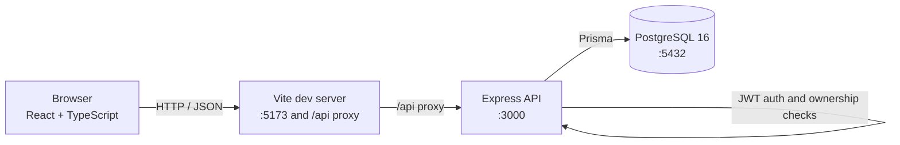

# Personal Finance Management System

A full-stack web application for recording income and expenses, tracking account balances, managing monthly budgets, and reviewing financial summaries. The UI is branded **Finance Manager**.

The project is a portfolio and learning project. It is not a production financial service: see [Security and limitations](#security-and-limitations).

## Overview

The application gives each registered user a private financial workspace:

- Money movements are recorded as income or expense transactions tied to an account and a category.
- Account balances are updated atomically with transaction changes.
- Monthly budgets track spending against an expense category.
- A dashboard and three report views summarize balances, income, expenses, and cash flow.
- Every protected resource is scoped to the authenticated user on the backend.

## Features

- **Authentication**: register, log in, log out, restore a session, and fetch the current user. Passwords are hashed with Argon2id. Access and refresh tokens are JWTs, and refresh tokens are stored hashed and rotated on use.
- **User-specific data**: the backend derives the user ID from the access token. Requests cannot select another user's data through a `userId` parameter.
- **Accounts**: create, view, edit, and delete financial accounts with types `CASH`, `BANK`, `CREDIT_CARD`, `INVESTMENT`, and `OTHER`.
- **Categories**: create, view, edit, filter, and delete income or expense categories. Names are unique per user and category type.
- **Transactions**: create, view, filter, sort, paginate, edit, and delete income and expense transactions. Filters cover type, account, category, amount range, and date range.
- **Balance integrity**: creating, editing, deleting, or moving a transaction updates the affected account balances inside a Prisma database transaction. An expense that would make a balance negative is rejected.
- **Monthly budgets**: one budget per user, category, year, and month. Progress includes budget amount, spent amount, remaining amount, percentage used, and a status (`UNDER_BUDGET`, `NEAR_LIMIT`, `OVER_BUDGET`).
- **Dashboard**: total balance, income, expenses, net cash flow, category breakdowns, and recent transactions, with optional date filtering.
- **Reports**: summary, expense-by-category, and daily cash-flow reports with date filters; expense reports can also be filtered by category.
- **Input validation and error handling**: Zod schemas validate request bodies, query strings, and route parameters on the backend. The API returns a consistent error envelope. The frontend provides form validation, loading states, empty states, and error messages.

## Technology Stack

| Area | Technologies |
|---|---|
| Frontend | React 19, TypeScript, Vite 8, React Router 7, TanStack Query 5, React Hook Form 7, Zod 4 |
| Backend | Node.js 22 (Docker and CI), TypeScript 5.9, Express 5, Zod 4, `jose`, Argon2 |
| Database and ORM | PostgreSQL 16, Prisma 7 with the `pg` driver adapter |
| Infrastructure and tooling | Docker, Docker Compose, ESLint, Prettier |
| Testing and CI | Vitest 5, Supertest, Testing Library, `jsdom`, GitHub Actions |

## Architecture



- The **frontend** renders the authenticated application, validates forms, calls the API through a shared client, and handles access-token refresh.
- The **backend** owns authentication, authorization, validation, business rules, balance changes, budget calculations, and report aggregation.
- **PostgreSQL** stores users, accounts, categories, transactions, budgets, and refresh-token records.

The browser calls same-origin `/api`; the Vite dev server proxies that path to the backend container. The backend does not implement CORS, so production hosting would need a same-origin reverse proxy or an intentional CORS configuration.

For implementation details, see [Docs/Architecture.md](Docs/Architecture.md).

## Project Structure

```text
.
├── backend/
│   ├── prisma/                 Prisma schema and migrations
│   ├── src/
│   │   ├── config/             Environment validation
│   │   ├── middleware/         Validation and error handling
│   │   ├── modules/            Feature modules (auth, accounts, categories,
│   │   │                       transactions, budgets, dashboard, reports)
│   │   ├── routes/             API router composition
│   │   ├── lib/                Prisma client and database setup
│   │   └── app.ts, server.ts   Express app and server entry point
│   └── tests/                  Unit, API, and database integration tests
├── frontend/
│   └── src/
│       ├── app/                Router and route guards
│       ├── components/         Shared layout and UI components
│       ├── features/           Feature-specific API, hooks, schemas, and UI
│       ├── lib/api/            Shared JSON API client
│       ├── pages/              Application pages
│       └── styles/             Application styles
├── Docs/                       Architecture, API, development, and release docs
├── .github/workflows/ci.yml    GitHub Actions CI
├── docker-compose.yml          Frontend, backend, and PostgreSQL services
└── .env.example                PostgreSQL settings for Docker Compose
```

## Prerequisites

- Git
- Docker Desktop (or Docker Engine) with Docker Compose v2
- No Node.js installation is required on the host when using the Docker workflow

The images use Node.js 22 Alpine and PostgreSQL 16 Alpine. CI uses Node.js 22.

## Quick Start (Docker)

1. Create the local environment files from the examples:

   ```powershell
   Copy-Item .env.example .env
   Copy-Item backend/.env.example backend/.env
   Copy-Item frontend/.env.example frontend/.env
   ```

   On macOS or Linux, use `cp` instead of `Copy-Item`.

2. Set `JWT_ACCESS_SECRET` and `JWT_REFRESH_SECRET` in `backend/.env` to two different long random values. For example:

   ```powershell
   $rng = [System.Security.Cryptography.RandomNumberGenerator]::Create()
   $bytes = New-Object byte[] 48
   $rng.GetBytes($bytes)
   [Convert]::ToBase64String($bytes)
   $rng.Dispose()
   ```

   Run the command twice and put one value in each variable. On macOS or Linux, `openssl rand -base64 48` is an equivalent option.

3. Generate the Prisma client, apply migrations, and start the services:

   ```powershell
   docker compose build
   docker compose run --rm --no-deps backend npx prisma generate
   docker compose up -d postgres
   docker compose run --rm backend npx prisma migrate deploy
   docker compose up
   ```

   The generated Prisma client is intentionally ignored by Git, so the `prisma generate` step is required after a fresh clone.

4. Open the application:

   - Frontend: <http://localhost:5173>
   - Backend health check: <http://localhost:3000/api/health>
   - API base URL: <http://localhost:3000/api>

The API does not serve a Swagger UI page. The OpenAPI document is [Docs/OpenAPI.yml](Docs/OpenAPI.yml); see [Docs/API.md](Docs/API.md) for how to use it.

For a step-by-step Docker workflow, tests, and troubleshooting, see [Docs/DEVELOPMENT.md](Docs/DEVELOPMENT.md).

## Development and Quality Checks

All application commands are intended to run inside the running containers; project dependencies do not need to be installed on the Windows host.

| Task | Command |
|---|---|
| View logs | `docker compose logs -f backend frontend postgres` |
| Apply migrations | `docker compose exec backend npx prisma migrate deploy` |
| Backend lint | `docker compose exec backend npm run lint` |
| Frontend lint | `docker compose exec frontend npm run lint` |
| Backend unit/API tests | See [Docs/DEVELOPMENT.md](Docs/DEVELOPMENT.md#8-backend-tests) |
| Backend integration tests | See [Docs/DEVELOPMENT.md](Docs/DEVELOPMENT.md#8-backend-tests) |
| Frontend tests | `docker compose exec frontend npm test` |
| Backend build and type check | `docker compose exec backend npm run build` |
| Frontend build and type check | `docker compose exec frontend npm run build` |
| Stop services | `docker compose down` |

The backend build runs `tsc`; the frontend build runs `tsc -b && vite build`. There are no separate type-check scripts.

The `format:check` scripts are not currently reliable: the backend checkout is not Prettier-clean, and the frontend does not install Prettier. Formatting is not part of CI. See [Docs/DEVELOPMENT.md](Docs/DEVELOPMENT.md#formatting) before using those scripts.

## API Documentation

- The OpenAPI 3.0 document is [Docs/OpenAPI.yml](Docs/OpenAPI.yml).
- During development the API is served at `http://localhost:3000/api`.
- The source of truth is the backend implementation; see [Docs/API.md](Docs/API.md) for verified endpoint groups, authentication steps, and request examples.
- To test protected endpoints, call `POST /api/auth/login`, then send `Authorization: Bearer <access-token>`.
- The OpenAPI document uses `http://localhost:3000/api` as its server URL. Browsers may block "Try it out" requests from external documentation tools because the backend has no CORS middleware; use the provided `curl` examples or a same-origin proxy instead.

## Security and Limitations

Implemented safeguards include Argon2id password hashing, signed JWTs with separate access and refresh secrets, hashed refresh-token records with rotation, backend resource-ownership checks, strict request validation, and centralized error responses that hide internal details.

Known limitations for reviewers:

- This is a development project, not a production-ready service. There is no public demo deployment.
- The frontend stores access and refresh tokens in `localStorage`, which is vulnerable if the application ever suffers an XSS defect.
- The backend has no CORS middleware, rate limiting, security-header middleware, email verification, or password-reset flow.
- Docker images run the development servers (`tsx watch` and Vite), not production builds.
- Test-support routes (`/api/validation-test`, `/api/auth-test`, and `/api/test-resources`) are mounted in the main application. Remove or disable them before any public deployment.
- The budget status boundary is implemented as `NEAR_LIMIT` at exactly 100% usage; `OVER_BUDGET` starts above 100%. This differs from an earlier design note in [Docs/Detailed Design.md](Docs/Detailed%20Design.md).
- No screenshots are included because no verified current screenshots were available. No demo URL is included because no working deployment was verified.

See [Docs/RELEASE_READINESS.md](Docs/RELEASE_READINESS.md) for the release checklist and verification status.

## Documentation

- [Architecture](Docs/Architecture.md)
- [API guide](Docs/API.md)
- [Docker development and testing](Docs/DEVELOPMENT.md)
- [Release readiness checklist](Docs/RELEASE_READINESS.md)
- [Original system architecture design](Docs/System%20Architecture.md)
- [Original detailed design](Docs/Detailed%20Design.md)

## Project Status

Development/portfolio project. The documented setup and quality-check commands were checked against the repository configuration. Lint, test, and build checks pass; the formatting scripts have known issues described above. A clean-environment startup was not executed during the documentation review. See the release checklist for which checks were executed and which remain unverified.
